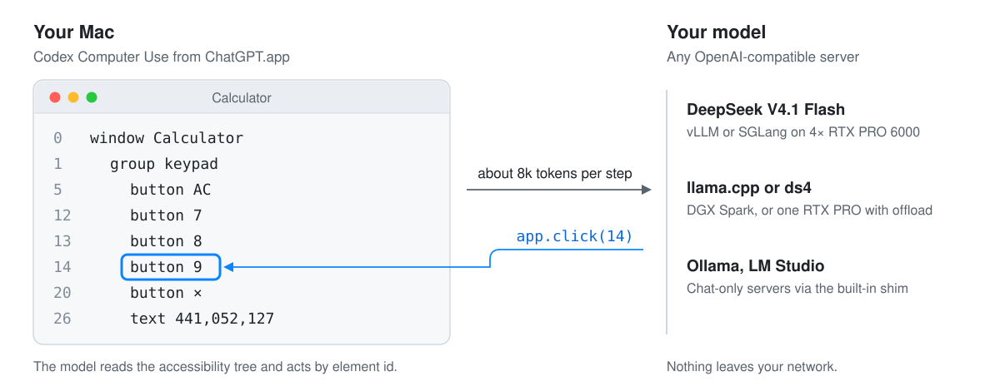
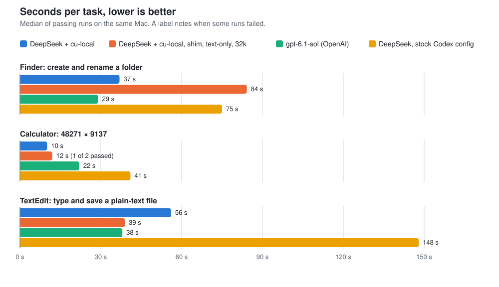

# cu-local

Run OpenAI's Codex Computer Use on your Mac with your own model.

<p align="center"></p>

The Computer Use plugin in ChatGPT.app is one of the best ways to let a model operate a Mac. It reads each app's accessibility tree, acts by element id, and works in background windows without taking over your screen. Out of the box it only talks to OpenAI's models. cu-local points it at a model you host instead: DeepSeek V4.1 Flash on a GPU server, a DGX Spark, a single RTX PRO, or anything Ollama, llama.cpp or LM Studio can serve.

Without cu-local, two things go wrong when you try this. **Every step carries your entire Codex setup**: your instructions and every MCP server and tool. On our setup that was about 140k tokens per step, so a 30-second task took minutes. And **most local servers only half-speak the Responses API** that Codex now requires, so tool calls quietly disappear. cu-local fixes both.

## Quick start

```bash
curl -fsSL https://raw.githubusercontent.com/puretensor/cu-local/main/install.sh | sh
cu-local doctor --endpoint http://YOUR-SERVER:8000/v1 --save
cu-local run "Open Calculator and compute 48271 × 9137"
```

You need:
- macOS 15 or later;
- ChatGPT.app, with Computer Use enabled once in the app (macOS asks you to grant it Accessibility and Screen Recording);
- the macOS system `python3` (3.9+);
- a model server your Mac can reach.

`doctor` checks all of this, probes your server, and saves the settings it recommends.

## How fast

<p align="center"></p>

<!-- bench-table -->
| Configuration | Finder | Calculator | TextEdit | Passed | Input tokens per task (median, mostly cache hits) |
|---|---:|---:|---:|---:|---:|
| DeepSeek + cu-local | 37 s | 10 s | 56 s | 6/6 | 246,830 |
| DeepSeek + cu-local, shim, text-only, 32k | 84 s | 12 s | 39 s | 5/6 | 459,117 |
| gpt-6.1-sol (OpenAI) | 29 s | 22 s | 38 s | 3/3 | 190,076 |
| DeepSeek, stock Codex config | 75 s | 41 s | 148 s | 3/3 | 2,268,081 |
<!-- /bench-table -->

All runs were on the same Mac, on the three reference tasks `cu-local bench` runs. Every result is checked by machine: the folder exists, the product is right, the file is saved. Times are wall-clock for the whole task, including the app's own animations. DeepSeek is [DeepSeek-V4.1-Flash-1017](https://huggingface.co/deepseek-ai/DeepSeek-V4.1-Flash-1017) on 4× RTX PRO 6000 with vLLM. Raw results are in [`bench-results/`](bench-results).

Some honest caveats:
- These are small samples: two runs per task for cu-local, one for the reference rows. Treat differences under about 10 s as noise.
- In the cu-local runs, TextEdit saved into a hidden folder, which costs the model extra Save-dialog steps that the reference runs didn't have. `cu-local bench` now uses a visible folder.
- The one failed text-only run was a mistyped digit the model couldn't see to correct.

Other backends, as protocol checks on 16 CPU cores, not speed claims:
- **Ollama 0.40 with qwen3-vl:8b** passed Calculator (46 s). On Finder and TextEdit the 8B model lost the thread.
- **llama-server with Qwen3-8B** made tool calls correctly through the shim but ran out of time on Finder (10 calls in 600 s).

Small models connect fine; they just aren't strong enough yet for multi-step desktop work.

## What it changes

cu-local doesn't modify ChatGPT.app or Codex. On every run it builds a separate, minimal Codex home in `~/.cu-local` and launches the Codex binary bundled with the app against it.

- **Only the Computer Use tool.** The Computer Use server comes from your installed plugin. Your Codex config, AGENTS.md, skills and other MCP servers stay out of the prompt. Shell, file patching, web search and sub-agents are switched off, so the first step is about 8k tokens.
- **A model profile your server can honour.** cu-local copies Codex's own profile for its current GPT model from your local cache, so your model gets the same instructions and output limits. It then turns off everything that needs OpenAI's servers, such as server-side tool search and code mode.
- **A Responses-API shim for servers that need one.** If your server's `/v1/responses` can't carry Codex's namespaced tools (llama-server and some Ollama builds), cu-local runs a small local translator to `/v1/chat/completions`. It handles reasoning, parallel tool calls, screenshots inside tool results, and token usage. `--text-only` drops images for models without vision.

It's one Python file using only the standard library. Read it before you run it: [`cu_local.py`](cu_local.py).

## Your hardware

| Setup | Server | Status |
|---|---|---|
| Multi-GPU, e.g. 4× RTX PRO 6000 | vLLM or SGLang, DeepSeek V4.1 Flash | tested |
| One DGX Spark (128 GB) | ds4 or llama.cpp with a 1–2-bit GGUF | emulated |
| One RTX PRO 6000 with 256 GB or more of RAM | llama.cpp with experts offloaded to the CPU | community |
| Any Mac or PC | Ollama, LM Studio, llama.cpp with a small model | tested (expect lower success) |

[Recipes and flags for each →](docs/recipes.md)

"Emulated" means we ran the same model through the shim, text-only, with a 32k context: the limits a Spark build has, on faster hardware. If you run cu-local on a Spark or a single card, please [send a hardware report](../../issues/new?template=hardware-report.yml).

## Commands

| Command | What it does |
|---|---|
| `cu-local run "task"` | Run one task. Extra Codex flags go after `--`, e.g. `-- --json`. |
| `cu-local doctor --endpoint URL [--save]` | Check the Mac and the server, and recommend settings. |
| `cu-local bench [--repeats N]` | Run the reference tasks and check the results. Writes `results.json`. |
| `cu-local shim --upstream URL` | Run the Responses→Chat shim on its own, for any Responses client. |

Common options: `--model`, `--text-only`, `--context N`, `--shim on|off|auto`, `--effort low|medium|high`, `--idle-timeout SECONDS` for slow servers, `--api-key-env VAR`.

## Safety and privacy

- The model gets the Computer Use tool and nothing else. Pass `--allow-shell` if you really want it to have a shell.
- Computer Use asks before it controls each app, and you can stop it at any time with Esc. It's still a model operating your computer: keep it away from banking, password managers and anything you can't undo.
- Model requests go only to the server you configure, and Codex analytics are switched off in cu-local's config. The Computer Use plugin is OpenAI software, and its own settings in ChatGPT.app still apply (for example, whether screenshots may be used for training). Check them.

## Limits

- macOS only, because that's where Codex Computer Use runs. cu-local needs a ChatGPT.app install with Computer Use available on your plan and in your region.
- OpenAI can change how the plugin or model profiles are laid out in any app update. `cu-local doctor` checks both and says what broke.
- Small models can operate simple apps but drift on longer tasks. In our runs, DeepSeek-class models were the first local models that were reliable.

## Development

```bash
python3 -m unittest discover -s tests -v   # offline; runs on Linux too
sh scripts/leak-scan.sh                    # before every push
python3 scripts/render-bench.py            # redraws assets/bench.svg from bench-results/
```

See [CONTRIBUTING.md](CONTRIBUTING.md).

---

cu-local is an independent project by [PureTensor](https://puretensor.ai). It is not affiliated with or endorsed by OpenAI. "ChatGPT" and "Codex" are trademarks of OpenAI. cu-local ships none of OpenAI's code; it reads your own ChatGPT.app installation at runtime. MIT licensed.
